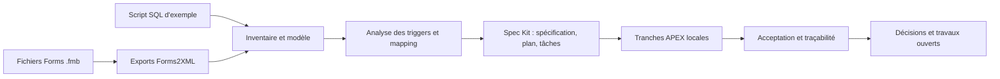

# Example Oracle Forms
# Oracle Forms vers Oracle APEX

**Une migration incrémentale, documentée et vérifiable de trois exemples Oracle Forms vers une première tranche Oracle APEX.**

Ce dépôt réunit les formulaires `QAFE_FORM1`, `QAFE_FORM2` et `QAFE_FORM3`, leur schéma SQL d’exemple, les exports Forms2XML et les artefacts de conception d’une migration vers Oracle APEX. Le but n’est pas de convertir automatiquement des écrans, mais de retrouver les comportements à partir des sources, de séparer les faits des hypothèses et de valider chaque tranche avant d’élargir le périmètre.

## Résumé

Les modules Forms sont des fichiers binaires `.fmb`. Ils sont accompagnés d’un script SQL qui décrit un modèle d’exemple autour des cours, sections, étudiants, instructeurs et notes. Le dépôt exporte les modules en XML pour l’analyse, puis relie les comportements observés aux exigences, décisions, composants APEX et scénarios de test.

L’application locale **QAFE Course Lookup** est créée dans Oracle APEX, dans un environnement de développement isolé. Elle sert de candidat de migration et de terrain de validation, pas de démonstration hébergée ni de système prêt pour la production.

## Périmètre et statut

| Parcours | État vérifié | Limite principale |
|---|---|---|
| Form 1 — catalogue de cours | Page APEX en lecture seule; colonnes `COURSE_NO`, `DESCRIPTION`, `COST`, tri croissant, 10 lignes par page. Cours 454–456 vérifiés; recherche clavier positive/négative, remise à zéro des filtres et affichage 375/1280 px testés. | Pas d’écriture continue; revue lecteur d’écran et matrice de navigateurs encore ouvertes. |
| Form 2 — instructeurs et étudiants | 10 instructeurs, 257 étudiants et leurs 146 ZIP référencés ont été copiés avec autorisation dans le preview local. Les rapports les affichent; les formulaires Builder ont passé update/delete sur des lignes synthétiques avec un propriétaire historique différent. | Copie locale/loopback uniquement. La source a 226 inscriptions mais aucune ne rejoint un cours existant; liens étudiants-cours non importés. ZIP périmé/annulation dédiée et concurrence restent à tester. |
| Form 2 — cours et sections | Les 62 sections source ont été copiées avec autorisation. Le lien affiche 4/3/3 sections pour les cours 454/455/456; le focus revient au lien d’origine au clavier et à la souris. | 52 sections référencent un `COURSE_NO` absent de COURSE et ne sont pas accessibles depuis les trois cours du preview. Concurrence et suppression master restent ouvertes; COURSE/SECTION sont en lecture seule. |
| Form 3 | Harness temporaire Builder-only: validations coût/fetch, comptages zéro/multiples et toggle avec `aria-pressed` vérifiés. Page 14 désactivée après tests. | Pas de parcours Form 3 destiné aux utilisateurs; annonces lecteur d’écran, navigation et toute extension d’accès nécessitent une décision. |

Les scénarios exécutés sont indiqués comme tels dans les registres; les autres ne sont pas réputés couverts. La migration globale n’est ni achevée ni certifiée pour la production.

## Démarche de migration

Le travail suit une chaîne de preuve plutôt qu’une conversion d’écran :



Les exports Forms2XML sont des artefacts d’analyse, pas des sources rééditables ou des remplacements des `.fmb`. Le modèle de données et les triggers SQL sont examinés séparément des comportements de l’interface. Un drapeau CRUD dans le XML ne prouve pas la persistance : certains triggers de vues ont des branches UPDATE/DELETE `WHERE 1 = 0`, traitées comme des écarts et non comme des succès.

## Spec Kit et spécification

Le dossier [`specs/001-forms-apex-migration/`](specs/001-forms-apex-migration/spec.md) structure la migration principale :

- `spec.md` décrit les user stories, exigences, critères et limites de preuve.
- `research.md` consigne les décisions de recherche et les alternatives.
- `plan.md` fixe les choix techniques, dépendances et gates.
- `tasks.md` ordonne le travail et suit l’avancement; plusieurs tâches de validation restent ouvertes.
- `quickstart.md` rassemble les prérequis et le parcours local vérifié.
- `checklists/requirements.md` suit la qualité et les décisions encore à prendre.

Le dossier [`specs/002-migration-audit/`](specs/002-migration-audit/spec.md) spécifie les outils locaux d’audit des preuves. Les workflows Spec Kit disponibles sous [`.github/skills/`](.github/skills/speckit-specify/SKILL.md) couvrent notamment la spécification, la planification, les tâches, les checklists, l’analyse et l’implémentation. Ces documents et skills guident le travail; ils ne signifient pas que chaque story est terminée.

## Audit local et IA agentique

Le cœur de [`tools/migration_audit/`](tools/migration_audit/README.md) est une boîte à outils Python déterministe, en lecture seule. Elle recherche des preuves dans les répertoires autorisés `docs/`, `specs/`, `tests/` et `script/`, inspecte uniquement les trois exports Forms connus, retrouve des lignes de traçabilité et signale les liens de test ou décisions ouverts. Les résultats de recherche incluent des chemins relatifs, des lignes et des extraits bornés.

La CLI ne lit pas `.env`, ne se connecte pas à Oracle, n’exécute pas de commandes système, n’appelle pas de modèle et ne modifie pas les fichiers. Pour la lancer depuis la racine :

```powershell
python -m tools.migration_audit audit
python -m tools.migration_audit search "WHEN-VALIDATE-ITEM"
python -m tools.migration_audit trace F3-TR-03
python -m tools.migration_audit inspect-form QAFE_FORM1
python -m tools.migration_audit open-items
python -m unittest discover -s tests/tools -v
```

[`tools/migration_audit/agent.py`](tools/migration_audit/agent.py) ajoute un adaptateur optionnel Microsoft Agent Framework. Il reçoit un client de fournisseur déjà configuré par l’appelant et expose les mêmes cinq outils de lecture. Le dépôt ne choisit ni ne configure de fournisseur ou de modèle; la CLI et ses tests fonctionnent sans agent. GitHub Copilot dans VS Code a été utilisé comme assistance au développement, mais n’est pas intégré à l’application APEX ni requis pour exécuter l’audit local.

## Environnement local et sécurité

La référence locale utilise Oracle Database 19c, Oracle APEX 24.2 et ORDS 26.3 dans le PDB de développement `QAFE_CLEAN`. Le service ORDS est limité à l’interface loopback. L’environnement n’est pas une cible de production; son accès, ses données et les opérations APEX ne doivent pas être exposés au réseau.

Les opérations autorisées sont limitées par la [matrice de sécurité](docs/security-matrix.md). Les tests utilisent des fixtures synthétiques; les lignes temporaires Form 2 et ZIP ont été supprimées. Les trois cours 454–456 sont des exemples locaux en lecture seule. Les fichiers `.env` ne sont pas documentés ni nécessaires pour lire ce dépôt. N’exécutez pas directement le script SQL d’exemple sur une base de production.

Pour les prérequis, la configuration et les vérifications locales, voir [l’environnement APEX](docs/apex-environment.md), le [guide local](specs/001-forms-apex-migration/quickstart.md) et le [checkpoint de reprise](docs/resume.md). Les identifiants ne sont pas fournis ici; toute authentification se fait directement dans le navigateur local.

## Documentation

### Sources et analyse Forms

- [Inventaire Forms](docs/forms-inventory.md) — blocs, fenêtres, items, relations et limites des exports.
- [Analyse des triggers](docs/trigger-analysis.md) — événements observés et règles SQL, avec leurs statuts de preuve.
- [Modèle de données](docs/data-model.md) — tables, clés, contraintes, vues, séquences et bindings.
- [Exports Forms2XML](docs/forms-exports/README.md) — provenance, options et empreintes des XML dérivés.
- [Script SQL d’exemple](script/student-db-script.sql) — DDL et code source de la base d’exemple; ne pas le traiter comme un jeu de données de production.

### Conception, sécurité et suivi

- [Mapping Form-to-APEX](docs/migration-mapping.md) — comportements observés et choix cibles.
- [Registre des risques](docs/migration-risks.md) — dépendances, ambiguïtés et gates.
- [Matrice de sécurité](docs/security-matrix.md) — acteurs, périmètres et autorisations locales.
- [Matrice de traçabilité](docs/traceability-matrix.md) — source, exigence, comportement APEX, test et preuve.
- [Spec Kit — migration](specs/001-forms-apex-migration/spec.md) · [plan](specs/001-forms-apex-migration/plan.md) · [tâches](specs/001-forms-apex-migration/tasks.md) · [recherche](specs/001-forms-apex-migration/research.md).
- [Spec Kit — audit](specs/002-migration-audit/spec.md) · [plan](specs/002-migration-audit/plan.md) · [tâches](specs/002-migration-audit/tasks.md).
- [État de reprise](docs/resume.md) — environnement courant, résultats datés et prochain gate.

### Acceptation et outils

- [Guide des tests d’acceptation](tests/acceptance/README.md) et [inventaire](tests/acceptance/US1-inventory.md).
- [Recherche Form 1](tests/acceptance/US2-search.md) · [CRUD Form 1](tests/acceptance/US3-crud.md) · [validations](tests/acceptance/US4-validation.md).
- [Données liées Form 2](tests/acceptance/US5-related-data.md) · [acceptation de tranche](tests/acceptance/US6-slice-signoff.md) · [qualité plateforme](tests/acceptance/platform-quality.md).
- [Guide des outils d’audit](tools/migration_audit/README.md) et [export de l’application APEX](apex/QAFE_MIGRATION.sql) — à examiner avant tout import.

## Structure du dépôt

- `QAFE_FORM1.fmb`, `QAFE_FORM2.fmb`, `QAFE_FORM3.fmb` — modules Forms d’origine; leur contenu binaire s’inspecte avec les outils Oracle Forms appropriés.
- `docs/forms-exports/` — XML Forms2XML dérivés, conservés comme preuves d’analyse.
- `script/` — script SQL du schéma exemple, vues, triggers et données historiques à ne pas charger aveuglément.
- `specs/` — spécifications et plans Spec Kit pour la migration et l’audit.
- `apex/` — export lisible de l’application APEX et règles de conservation associées.
- `tests/` — scénarios d’acceptation, politique de fixtures et tests unitaires des outils.
- `tools/migration_audit/` — CLI déterministe et adaptateur agentique optionnel.
- `docs/` — inventaire, mapping, sécurité, risques, traçabilité et preuves d’environnement.
- `scripts/` — utilitaires locaux de provisionnement et de réinitialisation; à utiliser uniquement après lecture de leurs prérequis et limites.

## Démarrage local

L’aperçu APEX n’est pas un site hébergé : il nécessite l’environnement Oracle local documenté et un compte provisionné séparément. Pour le parcours vérifié et ses limites, suivre le [quickstart](specs/001-forms-apex-migration/quickstart.md) et [docs/apex-environment.md](docs/apex-environment.md). Gardez ORDS sur loopback; ne copiez aucun secret dans le dépôt, un terminal partagé ou un rapport.

Les outils d’audit, eux, peuvent être exécutés indépendamment de la base et d’APEX avec les commandes ci-dessus, depuis la racine du dépôt.
